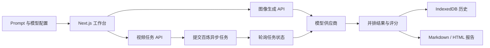

<div align="center">

# ImageBench

**在同一个工作台里，用相同提示词并行比较多个图像与视频生成模型。**

[](https://nextjs.org/)
[](https://www.typescriptlang.org/)
[](LICENSE)
[](https://github.com/magau123/ImageBench)

[功能](#功能) · [快速开始](#快速开始) · [模型接入](#模型接入) · [使用方法](#使用方法) · [开发](#开发) · [路线图](#路线图)

</div>

## 项目简介

ImageBench 是一个本地优先、BYOK（Bring Your Own Key）的多模型生成效果对比工具。它将同一条 Prompt 并行发送给多个模型，以统一卡片展示结果、耗时和错误，并支持人工评分、最佳结果标记、历史记录以及报告导出。

它不仅是模型 Demo，更面向真实交付场景：

- 软件架构图、流程图、ERD、DevSecOps、数据血缘等开发者任务
- PPT、经营看板、项目路线图、BPMN、年度报告等办公任务
- 任意自定义图像 Prompt
- 多镜头文生视频与不同 Wan 模型横向对比

## 功能

### 图像测评

- 同一 Prompt 并行调用 2–6 个模型
- 内置 20 个高难度办公与程序员实战题
- 支持完全自定义 Prompt
- 8 个评分维度、单模型重跑、胜出标记和同步缩放
- 浏览器 IndexedDB 本地历史
- 导出 `report.md + images/` 测评 Blog；不支持目录 API 时回退为自包含 HTML

### 视频测评

- 同一 Prompt 并行比较 2–4 个万相视频模型
- 支持 `wan3.0-video`、Wan 2.7 和 Wan 2.6
- 可设置 720P / 1080P、16:9 / 9:16 / 1:1、5 / 10 / 15 秒
- 原生视频播放、单模型重跑、六维评分、最佳结果标记和下载
- 按百炼官方异步协议自动创建任务并轮询结果

### 密钥与隐私

- API Key 不写入仓库
- 网页中填写的 Key 按服务商保存在本机浏览器（localStorage），再次选择该服务商时自动填入；清空输入框即删除
- Key 仅发送到本机 Next.js API 路由及对应模型供应商
- 默认无需登录、数据库或 Docker

## 快速开始

### 环境要求

- Node.js 20 或更高版本
- npm
- 至少一个已开通模型服务的 API Key

### Windows

```powershell
git clone https://github.com/magau123/ImageBench.git
cd ImageBench
npm install
Copy-Item .env.example .env.local
npm run dev
```

打开 <http://localhost:3000>。

### macOS / Linux

```bash
git clone https://github.com/magau123/ImageBench.git
cd ImageBench
npm install
cp .env.example .env.local
npm run dev
```

## 配置

所有环境变量都是可选的。你也可以直接在网页的模型卡片中临时填写 Key。

```dotenv
OPENAI_API_KEY=
REPLICATE_API_TOKEN=
FIREWORKS_API_KEY=
DASHSCOPE_API_KEY=

GOOGLE_CLIENT_EMAIL=
GOOGLE_PRIVATE_KEY=
GOOGLE_VERTEX_LOCATION=us-central1
GOOGLE_VERTEX_PROJECT=
```

不要提交 `.env.local`。项目的 `.gitignore` 已默认排除本地环境变量文件。

## 模型接入

图像生成当前支持：

- OpenAI：`gpt-image-1`、DALL·E
- OpenAI 兼容 / NewAPI：默认 `https://apinebula.ai/v1`，内置 `gpt-image-2.5`、`gpt-image-2` 等模型 ID
- 阿里云百炼千问生图：`qwen-image-3.0-pro`、`qwen-image-3.0`、Qwen Image 2.0 系列
- Google Vertex AI
- Replicate
- Fireworks

视频生成当前支持阿里云百炼万相：

- `wan3.0-video`
- `wan2.7-t2v`
- `wan2.7-t2v-2026-06-12`
- `wan2.6-t2v`

百炼视频链接有效期为 24 小时，请及时下载。视频按分辨率和时长计费，运行前请确认[百炼模型价格与限额](https://help.aliyun.com/zh/model-studio/text-to-video-guide)。

## 使用方法

### 比较图像模型

1. 选择实战题库，或点击“自定义 Prompt”。
2. 增加 2–6 个模型窗口。
3. 选择供应商和模型，填写对应 API Key。
4. 点击“开始对比”。
5. 对结果评分、标记最佳，并按需导出 Blog。

### 比较视频模型

1. 在顶部切换到“视频测评”。
2. 输入包含主体、动作、运镜、分镜时间和声音要求的 Prompt。
3. 选择分辨率、宽高比、时长和 2–4 个 Wan 模型。
4. 点击“开始视频对比”并等待异步任务完成。
5. 播放、评分、选优并及时下载结果。

## 工作原理



## 开发

```bash
npm run self-check
npm run typecheck
npm run lint
npm run build
```

主要目录：

```text
app/api/                  服务端模型适配与密钥代理
components/               图像、视频工作台及 UI
lib/benchmarks.ts         实战题库与评分维度
lib/provider-config.ts    图像供应商与模型配置
lib/history.ts            IndexedDB 历史适配
lib/report.ts             测评报告生成与导出
```

## 路线图

- [ ] 视频历史记录与报告导出
- [ ] 图生视频与首尾帧生成
- [ ] 更多视频供应商适配
- [ ] 批量 Prompt × 模型矩阵测试
- [ ] 盲测模式与 Elo 排名
- [ ] 可选的服务端团队协作存储

## 贡献

欢迎提交 Issue 和 Pull Request。新增供应商时，请保持 API Key 只在服务端路由中使用，并为非平凡转换逻辑补充最小可运行检查。

提交信息使用 Conventional Commits：

```text
feat: add a provider
fix: handle failed async task
docs: improve setup guide
```

## 许可证与致谢

本项目使用 [Apache License 2.0](LICENSE)。

ImageBench 基于 Vercel Labs 的 [AI SDK Image Generator](https://github.com/vercel-labs/ai-sdk-image-generator) 改造，并保留其版权和许可证声明。感谢 Vercel AI SDK、Next.js、Tailwind CSS、阿里云百炼及所有相关开源项目。
