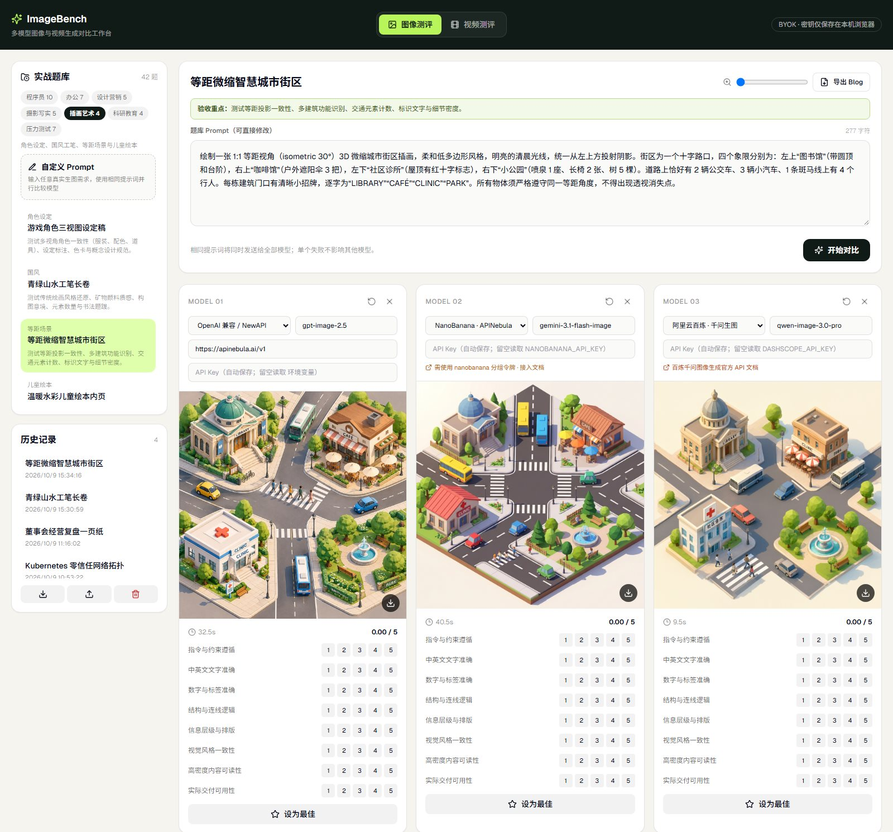
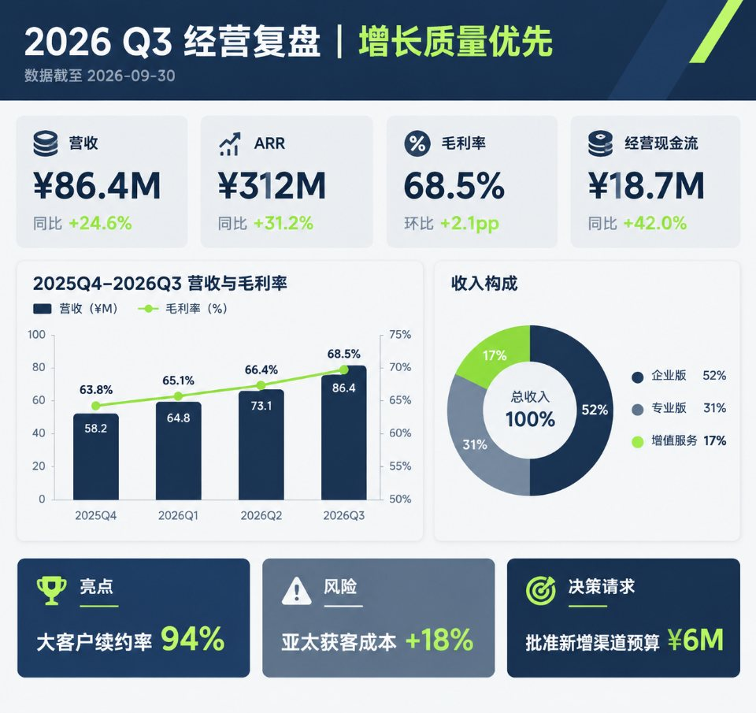
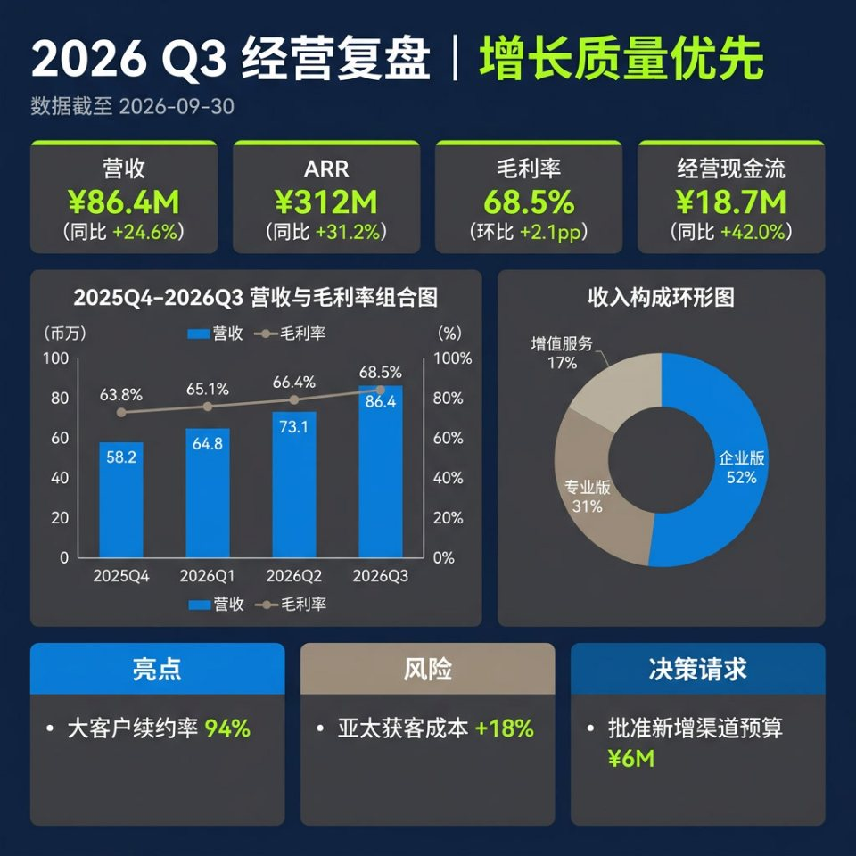
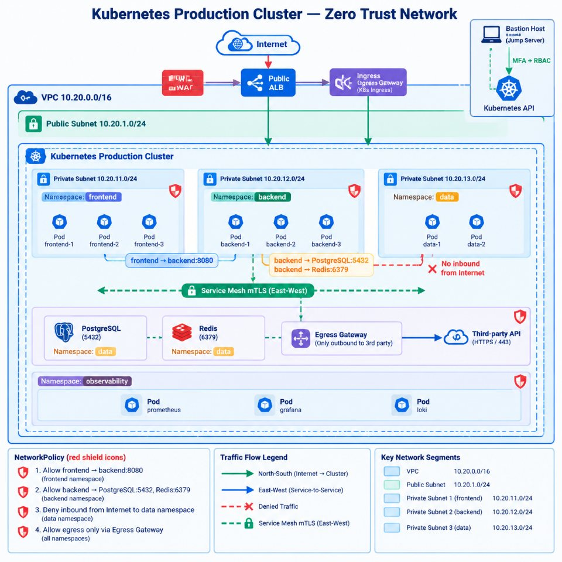
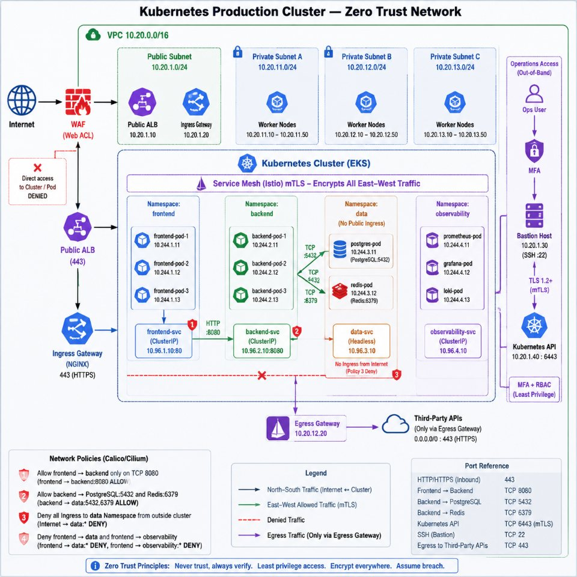
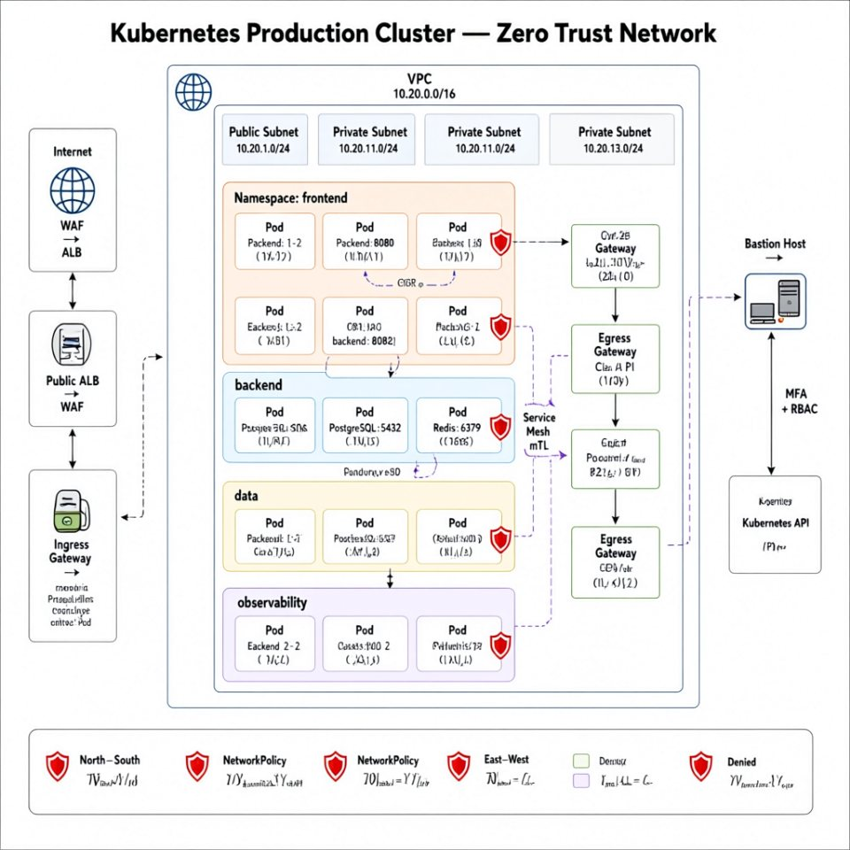
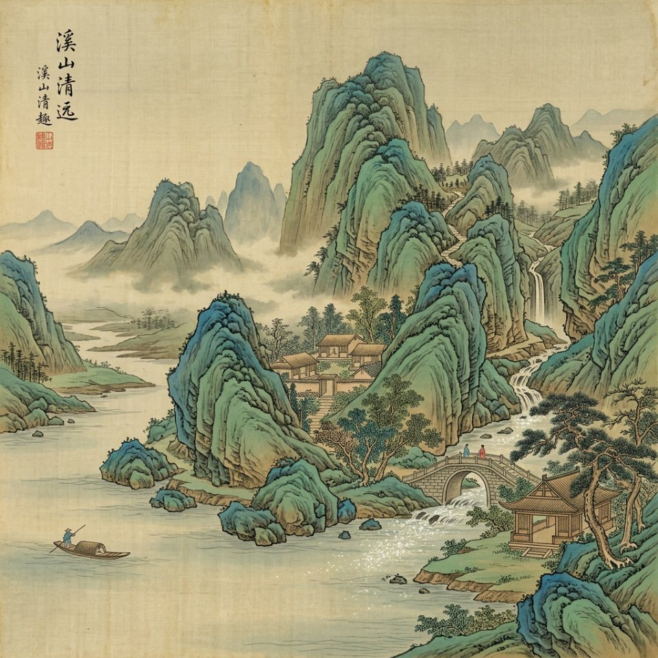
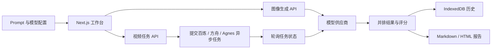

<div align="center">

# ImageBench

**在同一个工作台里，用相同提示词并行比较多个图像与视频生成模型。**

[](https://nextjs.org/)
[](https://www.typescriptlang.org/)
[](LICENSE)
[](https://github.com/magau123/ImageBench)

[功能](#功能) · [测评样例](#测评样例) · [快速开始](#快速开始) · [模型接入](#模型接入) · [使用方法](#使用方法) · [开发](#开发) · [路线图](#路线图)

</div>



## 项目简介

ImageBench 是一个本地优先、BYOK（Bring Your Own Key）的多模型生成效果对比工具。它将同一条 Prompt 并行发送给多个模型，以统一卡片展示结果、耗时和错误，并支持人工评分、最佳结果标记、历史记录以及报告导出。

它不仅是模型 Demo，更面向真实交付场景：

- 软件架构图、流程图、ERD、DevSecOps、数据血缘等开发者任务
- PPT、经营看板、项目路线图、BPMN、年度报告等办公任务
- 任意自定义图像 Prompt
- 多镜头文生视频，横向对比万相、Seedance 与 Agnes

## 功能

### 图像测评

- 同一 Prompt 并行调用 2–6 个模型
- 内置 42 道实战题，按程序员、办公、设计营销、摄影写实、插画艺术、科研教育、压力测试 7 个一级分类组织
- 支持完全自定义 Prompt
- 8 个评分维度、单模型重跑、胜出标记和同步缩放
- 浏览器 IndexedDB 本地历史
- 导出 `report.md + images/` 测评 Blog；不支持目录 API 时回退为自包含 HTML

### 视频测评

- 布局与图像测评一致：左侧分类题库 + 右侧多模型对比卡
- 18 道分类型提示词（电影叙事 / 产品营销 / 人物动作 / 运镜空间 / 风格艺术 / 压力测试）
- 支持阿里云百炼万相、豆包 Seedance（与 Seedream 共用 ARK Key）和 Agnes Video（与生图共用 Agnes Key）
- 可设置 720P / 1080P、16:9 / 9:16 / 1:1、5 / 10 / 15 秒
- 原生视频播放、单模型重跑、六维评分、最佳结果标记和下载

### 密钥与隐私

- API Key 不写入仓库
- 网页中填写的 Key 按服务商保存在本机浏览器（localStorage），再次选择该服务商时自动填入；清空输入框即删除
- Key 仅发送到本机 Next.js API 路由及对应模型供应商
- 默认无需登录、数据库或 Docker

## 测评样例

以下图片来自真实测评记录，每题均为同一 Prompt、单轮生成，未经挑选或后期处理。耗时包含中转网络开销，仅供参考；正式结论建议每题重复多轮。

### 办公 · 董事会经营复盘一页纸

<table>
  <tr>
    <th>gpt-image-2.5 · 22.6s</th>
    <th>NanoBanana gemini-3.1-flash-image · 17.7s</th>
  </tr>
  <tr>
    <td></td>
    <td></td>
  </tr>
</table>

两个模型都准确还原了 4 张 KPI 卡、营收与毛利率组合图和收入构成环形图中的全部数字。gpt-image-2.5 采用浅色卡片式版面，更接近 PPT 交付稿；NanoBanana 采用深色主题，但纵轴单位误写为“币万”。

### 程序员 · Kubernetes 零信任网络拓扑

<table>
  <tr>
    <th>gpt-image-2.5 · 34.0s</th>
    <th>gpt-image-2 · 66.6s</th>
    <th>qwen-image-3.0-pro · 11.4s</th>
  </tr>
  <tr>
    <td></td>
    <td></td>
    <td></td>
  </tr>
</table>

高密度技术图是区分度最大的题型。两款 GPT 图像模型的 CIDR、端口、四条 NetworkPolicy 与图例基本可读，gpt-image-2 还自行补充了 Pod IP 和端口对照表；qwen-image-3.0-pro 出图最快，但节点内小字大面积乱码，结构也偏离了题目要求。

### 插画艺术 · 等距微缩智慧城市街区

<table>
  <tr>
    <th>gpt-image-2.5 · 32.5s</th>
    <th>NanoBanana · 40.5s</th>
    <th>qwen-image-3.0-pro · 9.5s</th>
  </tr>
  <tr>
    <td></td>
    <td></td>
    <td></td>
  </tr>
</table>

三者都保持了统一的等距视角。gpt-image-2.5 四块招牌齐全但“CLINIC”重复出现；NanoBanana 低多边形风格最贴合要求，但缺少“PARK”招牌；qwen-image-3.0-pro 把咖啡馆招牌写成了“CLIIC”，并把诊所招牌换成了中文。

### 插画艺术 · 青绿山水工笔长卷

<table>
  <tr>
    <th>gpt-image-2.5 · 42.9s</th>
    <th>NanoBanana · 25.2s</th>
  </tr>
  <tr>
    <td></td>
    <td></td>
  </tr>
</table>

gpt-image-2.5 遵循 Prompt 中的长卷构图，亭、桥上两人、村落、扁舟与“溪山清遠”题跋均按要求出现。NanoBanana 按工作台统一的 1:1 比例出图，绢本质感与石青石绿表现更浓郁，但题跋旁多写了一行“溪山清趣”。

## 快速开始

### 环境要求

- Node.js 20 或更高版本
- npm
- 至少一个已开通模型服务的 API Key

### Windows

```powershell
git clone https://github.com/magau123/ImageBench.git
cd ImageBench
npm install
Copy-Item .env.example .env.local
npm run dev
```

打开 <http://localhost:3000>。

### macOS / Linux

```bash
git clone https://github.com/magau123/ImageBench.git
cd ImageBench
npm install
cp .env.example .env.local
npm run dev
```

## 配置

所有环境变量都是可选的。你也可以直接在网页的模型卡片中临时填写 Key。

```dotenv
OPENAI_API_KEY=
REPLICATE_API_TOKEN=
FIREWORKS_API_KEY=
DASHSCOPE_API_KEY=
NANOBANANA_API_KEY=
ARK_API_KEY=
AGNES_API_KEY=
# 国内站默认 https://api.agnes-ai.cn/v1；国际站 Key 改为 https://apihub.agnes-ai.com/v1
AGNES_BASE_URL=

GOOGLE_CLIENT_EMAIL=
GOOGLE_PRIVATE_KEY=
GOOGLE_VERTEX_LOCATION=us-central1
GOOGLE_VERTEX_PROJECT=
```

不要提交 `.env.local`。项目的 `.gitignore` 已默认排除本地环境变量文件。

## 模型接入

图像生成当前支持：

- OpenAI：`gpt-image-1`、DALL·E
- OpenAI 兼容 / NewAPI：默认 `https://apinebula.ai/v1`，内置 `gpt-image-2.5`、`gpt-image-2` 等模型 ID
- 阿里云百炼千问生图：`qwen-image-3.0-pro`、`qwen-image-3.0`、Qwen Image 2.0 系列
- NanoBanana · APINebula 中转：`gemini-3.1-flash-image`、`gemini-3-pro-image-preview` 等，需使用 [nanobanana 分组令牌](https://docs.apinebula.ai/docs/advanced/image/nanobanana)
- 豆包 Seedream · 火山方舟：`doubao-seedream-5-0-pro-260628`、`doubao-seedream-5-0-flash-260915`，填写 [火山方舟 API Key](https://console.volcengine.com/ark/region:ark+cn-beijing/apiKey) 即可
- Agnes AI · 生图：`agnes-image-2.5-flash`、`agnes-image-2.1-flash` 等，[官方文档](https://wiki.agnes-ai.cn/zh-Hans/docs/agnes-image-21-flash)。国内 Key 使用默认 Base URL `https://api.agnes-ai.cn/v1`；国际站（platform.agnes-ai.com）Key 需改为 `https://apihub.agnes-ai.com/v1`
- Google Vertex AI
- Replicate
- Fireworks

视频生成当前支持：

- 阿里云百炼 · 万相：`wan3.0-video`、`wan2.7-t2v`、`wan2.7-t2v-2026-06-12`、`wan2.6-t2v`
- 豆包 Seedance · 火山方舟：`doubao-seedance-1-0-pro-250528`、`doubao-seedance-1-0-pro-fast-250528`、`doubao-seedance-2-0-fast-260128`
- Agnes AI · 生视频：`agnes-video-2.5-flash`、`agnes-video-2.5`（与图像共用 `AGNES_API_KEY`）

结果链接通常约 24 小时有效，请及时下载。视频按秒计费，运行前请确认账户余额与模型开通状态。

## 使用方法

### 比较图像模型

1. 在实战题库中先选一级分类再选题目，或点击“自定义 Prompt”。
2. 增加 2–6 个模型窗口。
3. 选择供应商和模型，填写对应 API Key。
4. 点击“开始对比”。
5. 对结果评分、标记最佳，并按需导出 Blog。

### 比较视频模型

1. 在顶部切换到“视频测评”。
2. 在左侧题库选择分类与题目，或自定义 Prompt。
3. 为每个窗口选择供应商（百炼 / Seedance / Agnes）与模型，填写 API Key。Agnes 还需确认 Base URL 与 Key 所属站点一致。
4. 设置分辨率、宽高比、时长后点击“开始视频对比”。
5. 播放、评分、选优并及时下载结果。

## 工作原理



## 开发

```bash
npm run self-check
npm run typecheck
npm run lint
npm run build
```

主要目录：

```text
app/api/                  服务端模型适配与密钥代理
components/               图像、视频工作台及 UI
lib/benchmarks.ts         图像实战题库与评分维度
lib/video-benchmarks.ts   视频分类题库
lib/provider-config.ts    图像供应商与模型配置
lib/video.ts              视频供应商与参数
lib/agnes.ts              Agnes 鉴权、站点与错误提示
lib/history.ts            IndexedDB 历史适配
lib/report.ts             测评报告生成与导出
```

## 路线图

- [ ] 视频历史记录与报告导出
- [ ] 图生视频与首尾帧生成
- [x] 更多视频供应商：万相、Seedance、Agnes Video
- [ ] 批量 Prompt × 模型矩阵测试
- [ ] 盲测模式与 Elo 排名
- [ ] 可选的服务端团队协作存储

## 贡献

欢迎提交 Issue 和 Pull Request。新增供应商时，请保持 API Key 只在服务端路由中使用，并为非平凡转换逻辑补充最小可运行检查。

提交信息使用 Conventional Commits：

```text
feat: add a provider
fix: handle failed async task
docs: improve setup guide
```

## 许可证与致谢

本项目使用 [Apache License 2.0](LICENSE)。

ImageBench 基于 Vercel Labs 的 [AI SDK Image Generator](https://github.com/vercel-labs/ai-sdk-image-generator) 改造，并保留其版权和许可证声明。感谢 Vercel AI SDK、Next.js、Tailwind CSS、阿里云百炼及所有相关开源项目。
